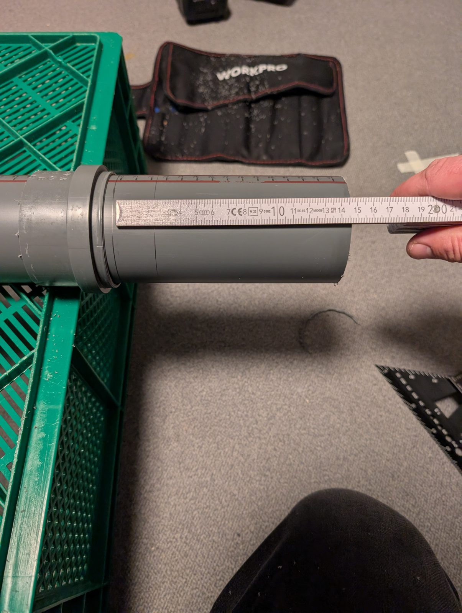

# Build guide

From one board of OSB to the first listen, in the order you'll do it. The
[building plan](building-plan.md) has every dimension; this guide
adds the order, the cutting plan and what was learned building and measuring this pair.

| | At a glance |
| --- | --- |
| **Result** | a pair of 27-litre vented boxes, 530 × 340 × 254 mm, Aiyima 4" full-range, port tuned to ≈ 48 Hz |
| **Material** | one 2000 × 1000 mm board of 22 mm OSB, square edges |
| **Tools** | track or circular saw, drill, Ø 94 / 75 / 70 mm hole saws or a router, clamps, stapler, multimeter |

## Parts list (per pair)

- [ ] 2 × Aiyima 4" full-range driver (8 Ω version)
- [ ] 1 × OSB board, 22 mm, 2000 × 1000 mm, **square edges** (no tongue and groove)
- [ ] 1 × HT drain pipe DN75 (75 mm outside, ≈ 71 mm inside), e.g. two 250 mm pieces
- [ ] beech strip 15 × 20 mm, ≈ 3.1 m (cleats for the back panel)
- [ ] foam gasket tape 3 × 10 mm, ≈ 3.5 m
- [ ] 32 × M4 threaded inserts and 32 × M4 × 30 pan-head screws with washers
- [ ] ≈ 60 × 4.5 × 60 mm countersunk wood screws
- [ ] 2 pairs of speaker terminals (Ø 12 mm holes)
- [ ] sheep's wool fleece (garden fleece / mulch mat, ≈ 10 mm, ≈ 140 g/m², e.g. a 5 × 0.5 m roll): one back-panel sheet and one pocket per speaker
- [ ] 2 × 50 g polyester fill (pillow stuffing)
- [ ] wood glue (PVA), clear water-based lacquer, acrylic sealant, speaker wire

## 1 — Cut the board

Every part is drawn to scale; 4 mm kerf and 10 mm trim on two edges are included.

1. Trim one long edge, 10 mm — the reference for every rip.
2. Trim one end square to it, 10 mm — the reference for every cross cut.
3. Five cuts straight across the board: **530 · 530 · 300 · 296 · 300**.
4. Cut each piece up:

| Piece | Cuts | Parts |
| --- | --- | --- |
| Block A | rip 340, 340 | 2 fronts, 530 × 340 |
| Block B | rip 210, 210, 210, 210 | 4 sides, 530 × 210 |
| Strip 1 | cut to length 482, 482 | 2 backs, 482 × 300 — rip to 292 later (step 10) |
| Strip 2 | cut to length 4 × 210 | 4 top/bottom, 296 × 210 |
| Strip 3 | cut to length 300, 300 | 2 doublers, 300 × 300 |

> **Tips** — Measure each width from the edge you just cut, not cumulatively. Cut the four sides and
> the four top/bottom panels in pairs against a stop. OSB tears out on the exit side: track saw show
> face up, circular saw show face down. Label every part and mark its show face as it comes off.
> Strip 1 has only 22 mm to spare: don't trim that long edge.

Downloads: [SVG](plans/cut-layout-2000x1000.svg) · [PNG](plans/cut-layout-2000x1000.png) ·
[generator script](plans/make_cut_layout.py)

## 2 — Drill the holes

| Hole | Size | Where |
| --- | --- | --- |
| Driver | Ø 94 mm | front, centred, 115 mm below the top — check against your driver first |
| Port | Ø 75 mm | front, centred, 150 mm above the bottom |
| Port | Ø 70 mm | doubler, centre |
| Terminals | 2 × Ø 12 mm | back panel, 40 mm apart (plan sheet 2) |

Chamfer the inside edge of the driver cutout so the cone can breathe. The Aiyima 4" fitted the
Ø 94 mm cutout.

## 3 — Seal the inside faces

OSB is porous and not airtight. Two coats of thinned lacquer on every inside face **before**
assembly; size the cut edges with thinned PVA and let it tack before gluing. A leaky box detunes the
port.

## 4 — Glue the cleats

Glue the beech cleats (2 × 486 on the sides, 2 × 266 between them on top and bottom) with their face
**23 mm in from the rear edge** — 22 mm back panel + 1 mm compressed gasket. Jig: lay a back panel on
the rear edges with 22 mm offcuts plus 1 mm of card underneath as spacers.

## 5 — Assemble the carcass

Sides, top and bottom: glue and screw (4.5 × 60, Ø 4.5 mm clearance hole, **Ø 3 mm pilot** — OSB
splits along the chip layers). Glue carries the joint, the screws are the clamps. Check the
diagonals; a back panel dry-fitted on wax paper holds it square.

## 6 — Front and doubler

Glue and screw the front on (18 screws on the 11 mm centre line, plan sheet 2). Glue the doubler
flush with the bottom edge, 20 mm in from each side; a 70 mm pipe offcut through both port holes
locates it.

## 7 — Seal the corners

A bead of acrylic sealant or a glue fillet in every inside corner.

## 8 — Finish

Sand 80, then 120 only — the resin-rich chips are harder than the binder, finer grits make the
surface wavy. Two to three coats of clear water-based lacquer.

## 9 — Inserts and gasket

Clamp a back panel in place, drill through it into the cleats, set the M4 inserts. Foam gasket on the
cleats, not on the back.

## 10 — Fit the back panel

Rip each back from 300 to its final width **after** the carcass is glued: measured opening minus
4 mm. Nominal **292 × 482 mm** for the 296 × 486 opening — 2 mm play per side. With 1 mm per side
(the plan's 294 × 484), OSB thickness tolerance and a box slightly out of square pinch the panel.

> **Lesson** — Build the back with the gasket and screws. During the measurements a friction-fit back
> leaked, and the leak changed with every refit: the port tuning moved by up to 10 Hz.

## 11 — Driver and wiring

Driver into the cutout with a thin gasket, terminals in the back panel, wire with enough slack to
take the back off. Check polarity is the same on both speakers.

## 12 — Port tube

An HT DN75 drain pipe extends the port inside the box. **Total port length 175 mm**, measured
straight through from the tube's inner end to the doubler's outer face. That tunes the box to
≈ 48 Hz — flat bass with the Aiyima ([why](06-step-2-port-tube.md)).

**Cut list for the tube:** as built (butted against the inside of the front, with flaps): 131 mm tube
+ 20 mm for the flaps = **151 mm piece**. Pushed into the Ø 75 front bore instead: **153 mm piece**.

Two ways to mount it from the inside:

- **Pushed into the Ø 75 front bore** up to the doubler, sealed with acrylic.
- **As built here:** eight 20 mm slits at one end (a 3 mm relief hole at the end of each), the flaps
  warmed and bent out 90°, four screwed to the inside of the front panel (3.5 × 12 mm), the joint
  sealed airtight.

> **Tip** — The tube ends ≈ 4.7 cm from the back-panel wool. Keep that space free; if you hear port
> noise ("chuffing") at high volume, trim 10 mm (Fb rises by 1–2 Hz). The plan's 117 mm tube (43 Hz)
> is for the Fostex FE103NV2.

## 13 — Damping

- **One layer of sheep's wool fleece** (≈ 10 mm) covering the inside of the back panel, opposite the port.
- **A wool pocket with 50 g of loose polyester fill**, puffy, across the **middle third of the box
  height** (≈ 16–32 cm above the inner floor), stapled to the back panel.

Keep ≈ 5 cm clear around the tube's mouth and behind the driver. Materials: sheep's wool garden fleece
(≈ 10 mm, ≈ 140 g/m²) and polyester fibre fill — the synthetic stuffing found in ordinary pillows.

> **The photo shows the test setup**, not a finished interior: this layout came out of eight
> measured variants where material was added and removed between measurements
> ([Damping](05-step-1-damping.md)). For the finished speaker, cut the fleece to the panel, sew the
> pocket and fix both securely.

## 14 — Close it and listen

Screw the back on (16 × M4). If you use a DSP, set a protective high-pass at ≈ 0.75 × Fb (36 Hz
here): below the port tuning the cone is unloaded. Start at a low level.

> **Optional, but worth it:** measure the impedance with a [50 Ω jig](03-impedance-jig.md) before you
> close the box for good. It confirms the port tuning and catches a leaking box in two minutes.
