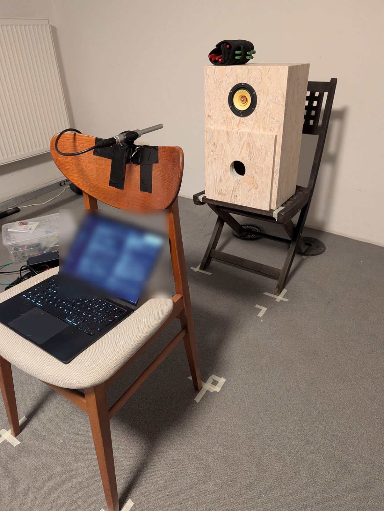
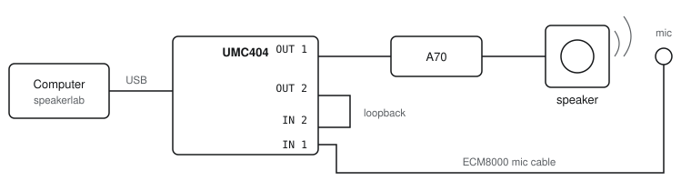
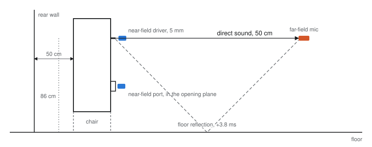

# Measurement rig

> *Part of **How it was measured** — optional reading. To build the speaker you only need the [build guide](01-build.md).*

Professional loudspeaker measurement doesn't need an anechoic room. It needs a reference, a
repeatable setup, and the right time window. Everything here is affordable, off-the-shelf gear.

*The setup: speaker on a chair (driver at 86 cm), the ECM8000 fixed at 50 cm, every position
marked on the floor.*

## Equipment

| Item | Role | Why this one |
| --- | --- | --- |
| **Behringer UMC404** (USB audio interface, 4 in / 4 out) | plays the sweeps, records mic, loopback and the jig | four inputs: mic, loopback reference and the two impedance probes at once; class-compliant |
| **Behringer ECM8000** (measurement microphone, omni, phantom powered) | the acoustic measurements | flat enough for comparisons, the standard budget measurement mic |
| **Aiyima A70** (class-D amplifier) | drives the speaker | the amplifier the speakers are used with |
| **Loopback cable** (jack–jack, OUTPUT 2 → INPUT 2) | timing and level reference | cancels the interface's latency and frequency response |
| **Impedance jig** (50.1 Ω resistor + leads) | electrical measurement of the port tuning | [build guide](03-impedance-jig.md) |
| Laptop with a Python measurement tool | sweep generation, deconvolution, analysis, plots | see [Method](04-method.md) |
| Multimeter | resistor value, wiring checks | |
| Masking tape, a ruler, a card spacer | repeatable positions | the cheapest and most important part |

## Signal chain

Output 2 is wired straight back into input 2. Every recording therefore carries its own reference:
the analysis divides by the loopback instead of the digital file, which cancels the interface's
latency (≈ 260 ms on this Mac) and its own response (flat within ±0.4 dB, 30 Hz–16 kHz), and
gives every measurement the same time zero — essential for adding driver and port near-field
responses with the correct phase.

## Microphone positions

| Position | Placement | Shows |
| --- | --- | --- |
| **Far field** | 50 cm from the dust cap, on axis, at driver height (86 cm) | the direct sound (time-gated before the floor reflection), mids, treble, distortion; and the in-room response |
| **Near-field driver** | ≈ 5 mm from the dust cap (card spacer) | the cone alone, room-free |
| **Near-field port** | centred in the port opening, in the plane of the front panel (a ruler across the opening as the reference) | what comes out of the port — where box resonances show up |

Driver height sets the usable gate: at 86 cm the floor reflection arrives 3.8 ms after the direct
sound, so the gated response is room-free above ≈ 290 Hz. Higher is better (1.2 m → ≈ 185 Hz).

## Making it repeatable

- **Floor marks** for the speaker's chair and the mic, height marks on the stand.
- **Taped knobs**: mic gain, loopback gain, amplifier volume. Comparisons across sessions only hold
  if none of them moves.
- **Fingerprints** checked at the start of every session: mic distance from the arrival time
  (54 cm for the 50 cm position — the acoustic centre sits behind the dust cap), the sweep peak at
  the mic (−11.6 dBFS) and the impulse peak-to-noise ratio (84 dB).
- **Re-placement tests:** the port near field repeated after moving the mic away and back agreed
  within 0.1–0.3 dB.

**Gain staging tip:** set the mic gain on the *sweep* peak (aim −15 to −10 dBFS), not on pink noise.
The sweep peaks about 12 dB higher than pink noise at the same setting; set by pink noise alone it
can clip in the near field.

**If a knob moved:** reset the loopback with a tone sent only to output 2 (back to its reference
level), and match the mic gain so the cone's output at 100–200 Hz equals an earlier session —
a range no port or damping change can affect.
