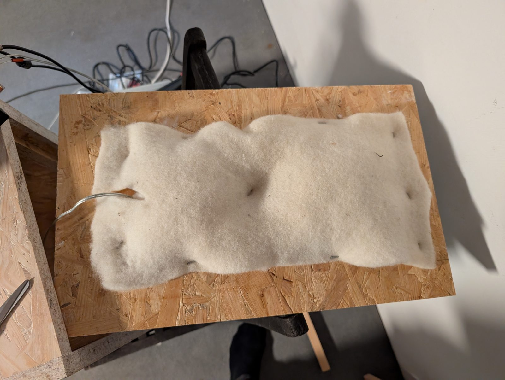
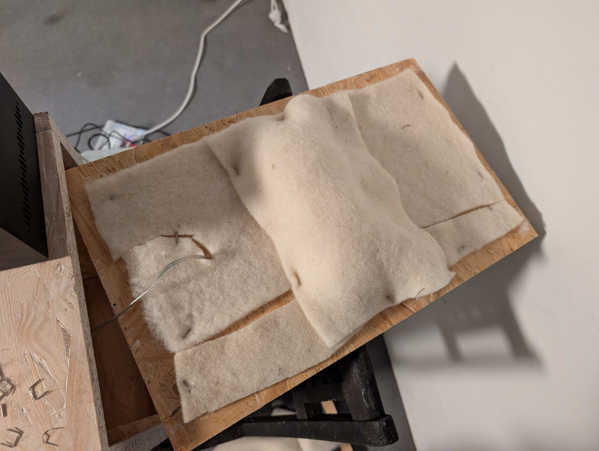
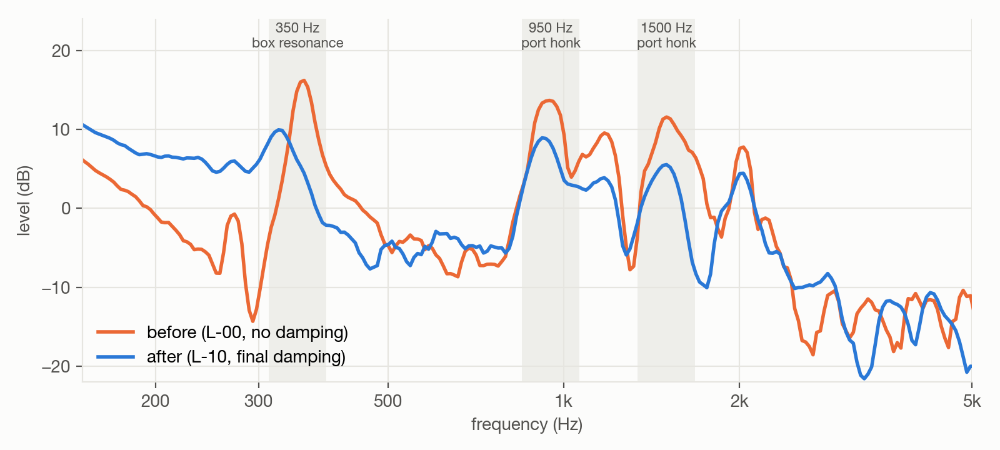
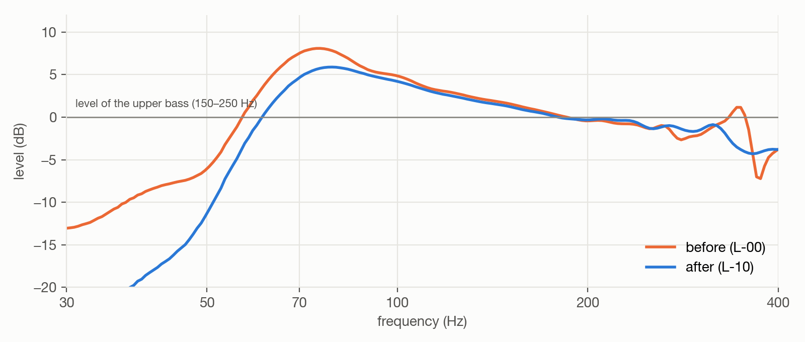
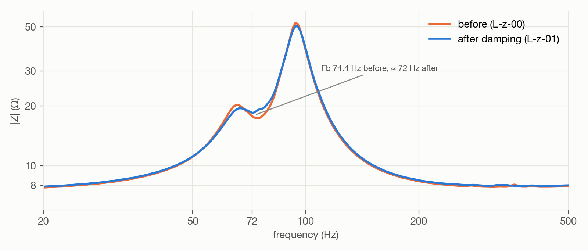
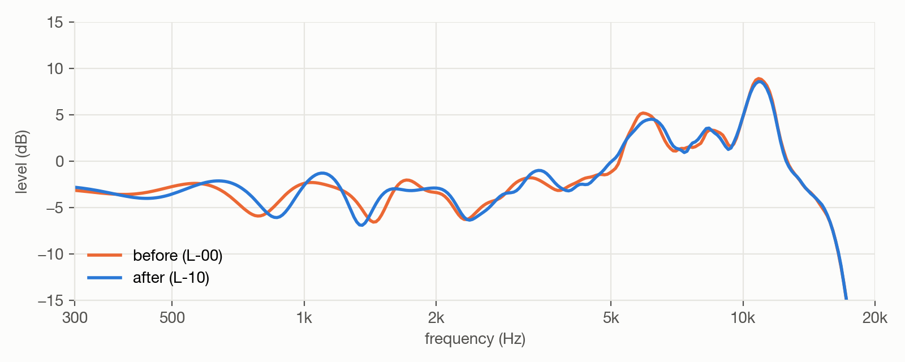

# Step 1 — Damping

**Question:** what does the untreated box actually do, and what damping does it need?
**Result:** three box resonances leak out of the port; a back-panel layout with one sheet of wool
felt per speaker plus a 50 g polyester pocket reduces them by 5–6 dB without touching the driver's
direct sound.

## Background: two terms

- **Box modes.** Above the bass, sound bounces between parallel inner walls and forms standing waves
  at f = c / 2L. In a vented box they escape through the port and colour the sound — "boxy" at the
  low ones, "honky" higher up. Damping material absorbs them.
- **Fb, the port tuning.** The air in the box acts as a spring, the air plug in the port as a mass;
  together they resonate at one frequency (a Helmholtz resonator, like blowing across a bottle). Fb
  is set by box volume and port dimensions, not by the driver. At Fb the port radiates most of the
  bass and the cone barely moves; below it the bass falls off steeply. A longer port lowers Fb.

## Baseline findings

Untreated box: bare 44 mm port, no damping (`L-z-00` impedance, `L-00-baseline` acoustic).

| | Finding | Evidence |
| --- | --- | --- |
| **P1** | **The driver is the 8 Ω version.** The supplied datasheet (Re 3.4 Ω, Fs 73 Hz, Qts 0.52) describes the 4 Ω version | impedance plateau 7.6–7.9 Ω; from the two peaks Fs ≈ 82 Hz, Vas ≈ 3.6 l (a new, stiff suspension) |
| **P2** | **Port tuned too high:** boomy, shallow bass | Fb = 74.4 Hz (predicted 61 Hz); bass sum +8.1 dB at ~75 Hz, steep fall below 55 Hz → *Step 2* |
| **P3** | **Height mode at 350 Hz** | +13 dB spike in the port near field; c / 2·0.486 m = 353 Hz |
| **P4** | **"Honk" at ~950 Hz and ~1.5 kHz** | ~950 Hz = front-to-back mode (c / 2·0.188 m = 912 Hz); ~1.5 kHz = the short port's own pipe resonance |
| **P5** | **Back panel leaks** | taping the seams raised port output ~1 dB and moved its peak 1 Hz; refits moved it up to 10 Hz |
| **P6** | **Treble peaks** | +7 dB at ~6 kHz, +11 dB at ~10.5 kHz (cone break-up) → correction EQ |

The box's dimensions predict the resonances that show up in the port output:

| Resonance | Dimension | Predicted | Measured |
| --- | --- | --- | --- |
| Height mode | 486 mm | 353 Hz | 350–360 Hz |
| Width mode | 296 mm | 579 Hz | not prominent |
| Depth mode | 188 mm | 912 Hz | ~945 Hz |
| Port pipe resonance | 44 mm + end corrections | ≈ 1.5 kHz | ~1.5 kHz |

## Rationale

Porous material absorbs where the air *moves*, not where pressure builds:

- **Height mode (350 Hz):** air velocity is highest halfway between top and bottom, across the
  whole cross-section → **thick, loose fill at mid-height**. The original plan points the same
  way ("50 mm foam … better against the 300 Hz mode").
- **Depth mode and port resonance:** the front-to-back wave reflects off the back panel, opposite
  the port's inner end → **wool on the back panel**, and fill that reaches into the box depth.

**Design goal for the production layout:** one sheet of wool felt per speaker, everything mounted
on the removable back panel.

## Eight variants, measured

| Round | Change | 350 Hz | 950 Hz | 1.5 kHz |
| --- | --- | ---: | ---: | ---: |
| `L-03` | 1 wool layer (~10 mm) on the back panel | −2.8 | −0.4 | −1.9 |
| `L-04` | 3 wool layers on the back panel | −7.0 | −5.0 | −5.6 |
| `L-05` | 3 layers + 50 g fill in a bag, free in the middle of the box | **−9.7** | **−11.2** | **−8.1** |
| `L-06` | fill as a flat cushion under one wool layer | −5.8 | −2.8 | −3.0 |
| `L-07` | 1 wool layer over the whole back panel | −3.3 | −0.1 | −2.7 |
| `L-08` | 1 layer + 25 g fill in a wool pocket at mid-height | −7.2 | −3.3 | −4.6 |
| `L-09` | **1 layer + 50 g pocket at mid-height — the production layout** | −8.2 | −5.1 | −6.3 |
| `L-10` | `L-09`, stapled, panel closed | −6.3 | −4.7 | −6.0 |

*dB change of the band maximum in the port near field vs. the baseline `L-00` (1/12 octave).*

`L-05` measures best; `L-09` is the production layout: one felt sheet per speaker, all on the back
panel, better than three plain layers, within 1.5 dB of `L-05` at 350 Hz. Only the depth mode stays
~6 dB behind — a free-standing bag reaches into the box depth, a panel pocket can't.

Photos of three variants

| | | |
| --- | --- | --- |
|  |  |  |
| `L-06`: fill pressed flat — about half the effect of a puffy pocket | `L-08`: one layer + 25 g pocket | `L-09`: one layer + 50 g pocket |

*Prototype fixtures, built to be changed between rounds. The finished speakers get the same layout,
neatly made.*

## Result

**Port output** — what leaks out of the box through the port:

*Port near field, 1/12 octave, 300 ms. The height mode, the depth mode and the port resonance are
5–6 dB lower.*

**Bass, driver + port** — the hump at 75 Hz shrinks from +8.1 to +5.9 dB. The fill adds losses: the
port gives up 1.5 dB at Fb and ~4 dB at 40 Hz, so the slope below 55 Hz gets steeper. The port tube
in Step 2 moves this whole region.

**Impedance** — the tuning drops from 74.4 to ≈ 72 Hz (the fill makes the box act slightly larger).
The dip between the bass peaks shrinks from ~3 Ω to ~1 Ω: more losses in the port circuit — the
limit for further damping.

**Direct sound at 50 cm** (gated, room-free) — unchanged within ±1 dB, as intended: damping works on
the box, not on the driver. In the room, at the mic, the 350 Hz region dropped ~2 dB.

| Problem | Before (`L-00`) | After (`L-10`) | Status |
| --- | --- | --- | --- |
| P3 height mode, 350 Hz | +13 dB spike | −6.3 dB | largely solved |
| P4 depth mode ~950 Hz / port pipe ~1.5 kHz | clear peaks | −4.7 / −6.0 dB | reduced; 950 Hz could go further |
| P5 back panel leak | port peak 70–80 Hz depending on fit | 71 Hz, panel closed | build the back with gasket + screws |
| P2 bass hump / Fb too high | +8.1 dB, Fb 74.4 Hz | +5.9 dB, Fb ≈ 72 Hz | → [Step 2](06-step-2-port-tube.md) |
| P6 treble peaks | +7 / +11 dB | unchanged | correction EQ |

## Limitations

- One speaker (L) measured; the second gets the same layout and one check measurement.
- The driver wasn't broken in: its suspension loosens over 10–20 h of use and moves the bass peaks a
  little.
- Port near-field data above ≈ 1.6 kHz are relative comparisons at a fixed position, not absolute
  levels.
- The friction-fit back panel's seating was the largest uncontrolled variable in the bass.
- The damping was measured as prototype fixtures; the neat production version gets one confirming
  measurement.
