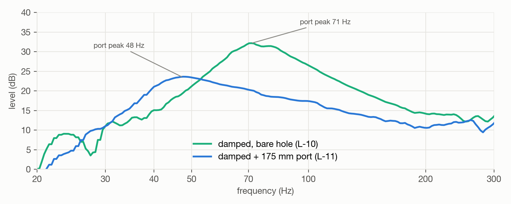
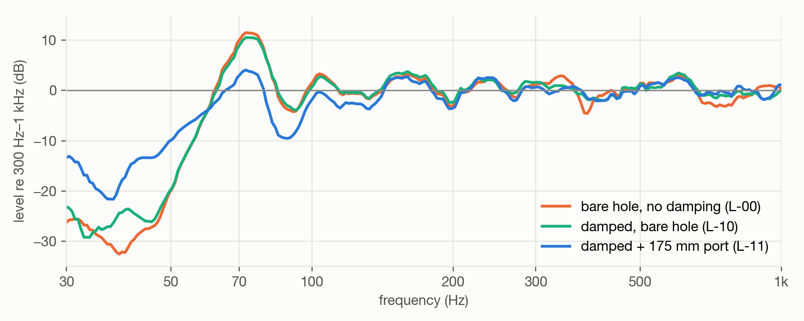
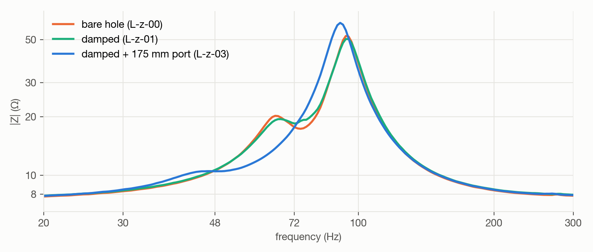

# Step 2 — Port tube

**Question:** where should the damped box be tuned for the Aiyima, and how long must the tube be?
**Result:** a 175 mm port moves the tuning from ≈ 72 Hz to **≈ 48 Hz**; the +8 dB bass hump turns
into a response flat within ±1 dB from 55 to 150 Hz.

## Target

- After damping the bare 44 mm port tuned to **≈ 72 Hz**, with a hump at ~79 Hz and a steep fall
  below 58 Hz.
- **Target ≈ 50 Hz.** The original design tunes to 43 Hz for the lean FE103NV2 plus a nearby wall;
  the Aiyima has more bass of its own ([Aiyima vs. FE103NV2](07-aiyima-vs-fe103.md)).
- **Constraint:** 188 mm inner depth. 43 Hz would need ≈ 216 mm of port; too close to the back
  panel the air at the tube's mouth gets choked.

## Prediction

The tube length is scaled from the **measured** tuning (Helmholtz: Fb ∝ 1/√Leff, with
end correction), so no box model is needed. From Fb = 72 Hz at 44 mm:

| Target Fb | Total port | |
| --- | ---: | --- |
| 55 Hz | 112 mm | fuller, less deep |
| 50 Hz | 146 mm | the target |
| ≈ 46.5 Hz | **175 mm** | fitted — cut long, to trim towards 146 mm |
| 43 Hz (plan) | 216 mm | doesn't fit the 188 mm depth |

## Build

HT DN75 drain pipe, mounted from the inside against the front panel, joint sealed. **Total port =
tube + front panel + doubler = 175 mm, measured straight through.** ≈ 4.7 cm clear to the
back-panel wool. Details: [Build → Port tube](01-build.md#12-port-tube).

## Verification

Four independent checks, then the ears:

1. **Impedance** (`L-z-02`; `L-z-03` with all seams and the tube base taped, to rule out leaks).
2. **Port near field** — where the port's output peaks is Fb.
3. **Bass sum** (cone + port, complex, area-scaled) — its shape decides whether the tuning is right.
4. **Far field** at 50 cm — gated (direct sound) and 300 ms (in the room).
5. **Listening A/B** — left (tube) against right (same damping, no tube) with equal-level test signals.

> **Reference control** — two gain knobs had moved between sessions. The loopback gain was reset with
> a tone sent only to the loopback (back to −22.3 dBFS, as in every earlier session); the mic gain
> was matched so the cone's output at 100–200 Hz equals the pre-tube session within 0.5 dB — a range
> no port can change. Far-field fingerprint afterwards: mic −10.9 dBFS (was −11.6), loopback
> −22.2 dBFS, arrival 1.63 ms.

## Results

**The speaker now, 30 Hz–20 kHz, room-free:**

*Below 400 Hz the near-field cone + port sum, above it the 3.4 ms gated far field, level-matched at
the splice. From ~45 Hz to 4 kHz within about ±4 dB; the bass hump is gone. Two things remain: the
treble peaks at ~6 and ~10.5 kHz (for a correction EQ), and the near-field part is half-space — free
standing, the bass sits a few dB lower relative to the mids (baffle step), which a nearby wall gives
back.*

**Bass, cone + port**, levelled to 150–250 Hz: with the 175 mm port **within ±1 dB from 55 to
150 Hz, −3 dB at 47 Hz, −7 dB at 40 Hz** — "flat down to a point, then a clean roll-off". The
length is right; it stays.

**Port output:** the peak — the tuning — moved from 71 to **47.6 Hz**; the port delivers ~6 dB more
at 40 Hz and leaves 70–100 Hz to the cone.

**In the room** (50 cm, 300 ms): the 70 Hz peak drops from +10 to +3 dB, 40–50 Hz rise by 6–12 dB.
The room still shapes the bass (rear wall 50 cm behind the speaker) — that's for placement, not
the tube.

| | Damped, bare hole | 175 mm port |
| --- | --- | --- |
| Port tuning Fb | ≈ 72 Hz | **≈ 48 Hz** |
| Bass hump | +5.9 dB at 79 Hz | **none** (max +1.0 dB) |
| −3 dB point | 58 Hz | **47 Hz** |
| Bass sum at 40 Hz | −18.6 dB | **−7.1 dB** |
| Direct sound above 300 Hz | unchanged within 1 dB | |

**Impedance:** the upper peak grows and moves from 93.8 to 91.1 Hz, as expected for a lower tuning.
The lower peak and the dip that mark Fb shrink to a plateau at 45–50 Hz: the port resonance is heavily
damped (the fill, and wool close to the tube's mouth). Taping every seam changed little, so it isn't a
leak. Fb is therefore read from the port near field (47.6 Hz) and confirmed by the plateau
([Impedance jig](03-impedance-jig.md)).

## Listening

Equal-level test signals sent to one speaker at a time — a bass staircase of single notes from
40 to 120 Hz and a slow sweep 30–200 Hz — left speaker (175 mm port) against right (same damping,
no tube yet).

> **"Not a huge bass addition, but the speaker sounds more balanced in some way."**

That's the measurement in words: the tube doesn't add level, it removes the hump at 70–80 Hz that
read as "lots of bass" and spreads the output evenly down to ~47 Hz.

## Conclusion

- **The first cut landed on target.** Partly luck — but the prediction came from the measured
  tuning, and three independent checks (port near field, bass sum, impedance plateau) agree on
  ≈ 48 Hz.
- **Measurement makes it verifiable, the ears make it final.** Tuning further would trade evenness
  against bass quantity — a matter of taste.
- **Balance, not quantity.** For more bass level: placement closer to a wall (as the original design
  intends), a gentle EQ shelf, or loudness compensation.

## Open

- **Port noise at high level** (only 4.7 cm to the back-panel wool): a loud listening test decides;
  if it chuffs, trim 10 mm (Fb +1–2 Hz).
- **Protective high-pass** in the DSP lowered from 56 Hz to **36 Hz** (0.75 × Fb).
