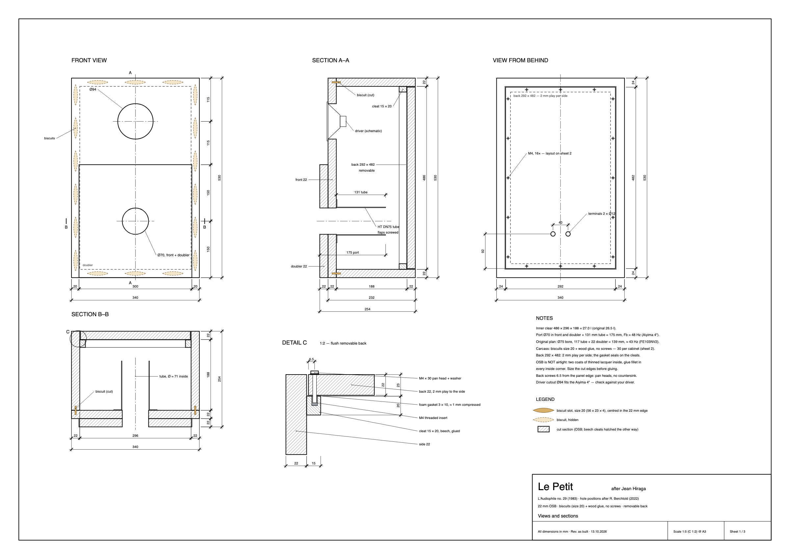
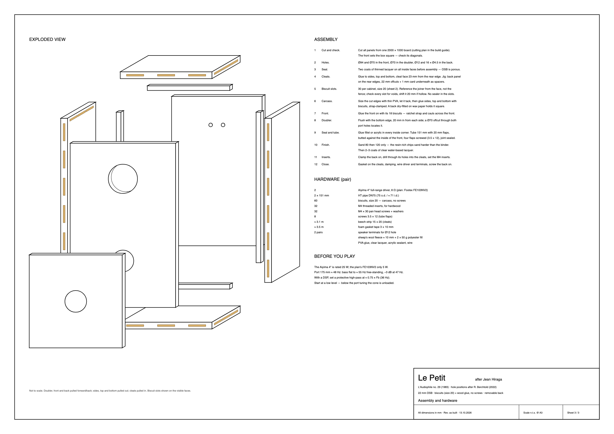

# Building plan

Le Petit after Jean Hiraga (*L'Audiophile* no. 29, 1983), hole positions after R. Berchtold (2022),
adapted to **22 mm OSB**, butt joints with **biscuits and wood glue (no screws in the carcass)** and a
**removable back panel**. All dimensions in mm. The drawings are vector files (SVG) — open them full
size to print at any scale.

> **The sheets show the speaker as built:** biscuit joints (every slot on sheet 2), the back panel
> **292 × 482** (2 mm play per side in the 296 × 486 opening), the port **Ø 70 in the front and the
> doubler** with a 131 mm tube on screwed flaps (175 mm total). Changes against the original plan:
> carcass screws → biscuits, back 294 × 484 → 292 × 482, front bore Ø 75 → Ø 70, tube 117 → 131 mm.
> The sheets are drawn by [make_building_plan.py](plans/make_building_plan.py).

## Sheet 1 — Views and sections

[Open sheet 1 (SVG)](plans/building-plan-sheet-1.svg)

## Sheet 2 — Panels and cut list

[Open sheet 2 (SVG)](plans/building-plan-sheet-2.svg)

## Sheet 3 — Assembly and hardware

[Open sheet 3 (SVG)](plans/building-plan-sheet-3.svg)

## Port (as built)

## Damping (as built)

## Dimensions

| | Size |
| --- | --- |
| Outside | 530 × 340 × 232 (H × W × D), 254 deep at the doubler |
| Inside clear | 486 × 296 × 188 = **27.0 l** (original 26.5 l) |
| Material | 22 mm OSB, butt joints with **biscuits (size 20) and wood glue — no screws in the carcass**; only the back panel is screwed (M4 into inserts) |
| Port | Ø 70 through the doubler **and** the front (the original plan: Ø 75 in the front); the plan's tube 117 + doubler 22 = 139 mm ≈ 43 Hz for the FE103NV2 — **with the Aiyima: 175 mm total, ≈ 48 Hz** ([Step 2](06-step-2-port-tube.md)) |

## Cut list

| Part | Size | Per box | Per pair |
| --- | --- | ---: | ---: |
| Front | 530 × 340 × 22 | 1 | 2 |
| Side | 530 × 210 × 22 | 2 | 4 |
| Top / bottom | 296 × 210 × 22 | 2 | 4 |
| Back | **482 × 292** × 22 | 1 | 2 |
| Doubler | 300 × 300 × 22 | 1 | 2 |
| Cleat, beech | 486 × 15 × 20 | 2 | 4 |
| Cleat, beech | 266 × 15 × 20 | 2 | 4 |
| Biscuits | size 20 | 30 | 60 |

OSB for the pair: 1.52 m² net — one 2000 × 1000 mm board ([cutting plan](01-build.md)).
Cut the cleats to fit the finished opening.

## Holes

| Hole | Size | Position |
| --- | --- | --- |
| Driver | Ø 94 | front, centred, 115 below the top — check against your driver first |
| Port | Ø 70 | front, centred, 150 above the bottom — same as the doubler |
| Port | Ø 70 | doubler, centre |
| Terminals | 2 × Ø 12 | back, 40 apart, centred, 92 up — not critical |
| Back screws | 16 × Ø 4.5 | through the back, no countersink: 56 / 90 / 90 / 56 across, 31 / 105 / 105 / 105 / 105 / 31 up, 6.5 from the edge |

Chamfer the inside edge of the driver cutout.

## Carcass joints: biscuits and glue

As built, the carcass is **glued with biscuits — no screws**. Sheet 2 shows every slot.
**30 biscuits per cabinet, size 20** (60 for the pair).

| Joint | Biscuits (positions in mm from the panel end) |
| --- | --- |
| Front onto the sides, along the 530 edges | 6 per edge at 45 / 133 / 221 / 309 / 397 / 485 |
| Front onto top and bottom | 3 per edge at 70 / 170 / 270 |
| Sides onto the ends of top and bottom | 3 per edge at 45 / 105 / 165 |

**Biscuits in OSB — what's different from MDF**

- **Reference from the face, not the fence.** OSB varies in thickness and the surface is uneven, so
  the fence wanders. Lay both parts face down on a flat surface and cut the slots from there. Size 20
  in a 22 mm edge leaves about 9 mm of material each side, centred.
- **Check every slot before gluing.** The cutter can run into a void between the chips; if a slot is
  hollow, move it 20 mm and cut again.
- **Keep sealer and lacquer out of the slots.** Saturate the edges with thinned glue beforehand, but the
  biscuits must swell into bare material.
- **More clamping pressure than usual:** a ratchet strap plus cauls across the front, or the joints open.

## Removable back (detail C)

| | |
| --- | --- |
| Cleats | beech 15 × 20, glued; their face sits **23 from the rear edge** (22 back + 1 compressed gasket) |
| Gasket | foam 3 × 10 on the cleats, compresses to ≈ 1 mm |
| Fixing | 16 × M4 threaded inserts in the cleats, M4 × 30 pan-head screws with washers (a countersink 6.5 mm from the panel edge breaks out) |
| Back panel | flush with the rear edge, 2 mm play per side |

## Assembly order

1. **Cut and check.** Cut all panels; the front sets the box square — check its diagonals.
2. **Holes.** Ø 94 and Ø 70 in the front, Ø 70 in the doubler, Ø 12 and 16 × Ø 4.5 in the back.
3. **Seal.** Two coats of thinned lacquer on all inside faces before assembly — OSB is porous.
4. **Cleats.** Glue to sides, top and bottom, face 23 mm from the rear edge (jig: back panel on the
   rear edges, 22 mm offcuts + 1 mm card as spacers).
5. **Biscuit slots.** Cut all 30 slots per cabinet (size 20), referenced from the face; check each for voids.
6. **Carcass.** Size the cut edges with thin PVA, let it tack, then glue sides, top and bottom with
   biscuits, strap-clamped. A back dry-fitted on wax paper holds it square. Check the diagonals.
7. **Front.** Glue it on with 18 biscuits; clamp with a strap and cauls across the front.
8. **Doubler.** Flush with the bottom edge, 20 mm in from each side; a 70 mm pipe offcut through both
   port holes locates it.
9. **Seal and tube.** Glue fillet or acrylic in every inside corner; fit and seal the port tube.
10. **Finish.** Sand 80 then 120 only, then 2–3 coats of clear water-based lacquer.
11. **Inserts.** Clamp the back on, drill through its holes into the cleats, set the M4 inserts.
12. **Close.** Gasket on the cleats, damping, wire driver and terminals, screw the back on.

## Hardware (pair)

| Qty | Item |
| ---: | --- |
| 2 | full-range drivers (plan: Fostex FE103NV2; this build: Aiyima 4", 8 Ω) |
| 2 | HT pipe DN75 (75 o.d. / ≈ 71 i.d.) — cut to length |
| 32 | M4 threaded inserts for hardwood |
| 32 | M4 × 30 pan-head screws + washers |
| ≈ 3.5 m | foam gasket tape 3 × 10 |
| 2 pairs | speaker terminals for Ø 12 holes |
| 60 | biscuits size 20 (carcass, no screws) |
| | damping — plan: 10 mm wool felt (≈ 1.2 m² per pair); this build: sheep's wool garden fleece (≈ 140 g/m²), one back-panel sheet + one pocket per speaker, and 2 × 50 g polyester fill |
| | PVA glue, clear lacquer, acrylic sealant, wire |

## Notes on the plan

- **OSB is not airtight.** Seal all inside faces with two coats of thinned lacquer and run a glue
  fillet or acrylic bead into every inside corner. Size the cut edges before gluing.
- **Cleat face 23 mm from the rear edge:** 22 mm back + 1 mm compressed gasket.
- **Back screws sit 6.5 mm from the panel edge** — use pan heads; a countersink this close to the
  edge breaks out.
- **Damping (plan):** 10 mm wool felt on all walls, or 50 mm foam on the floor and lower side walls,
  which is better against the low box mode. **Measured in this build:** one felt layer on the back
  panel plus a 50 g fill pocket at mid-height does the job with one sheet of felt per speaker
  ([Damping](05-step-1-damping.md)).
- **Check the Ø 94 driver cutout against your actual driver** before cutting.

## Before you play

- The plan's FE103NV2 is rated at **5 W** — fine with a low-power valve or class-A amp, less fine if
  someone else reaches for the volume knob. The Aiyima 4" used here is rated **25 W**.
- The plan's tuning (≈ 43 Hz) makes the FE103NV2's bass fall off below about 300 Hz; wall or corner
  placement helps, and a sub crossed at 100–150 Hz takes it further. With the Aiyima and a 175 mm
  port the bass is flat down to ≈ 55 Hz free-standing ([Step 2](06-step-2-port-tube.md)).
- With a DSP, set a protective high-pass at ≈ 0.75 × Fb (36 Hz for Fb ≈ 48 Hz).
