# Le Petit on a budget

**Jean Hiraga's Le Petit from a single sheet of OSB, with an affordable Aiyima 4" full-range driver —
built on a budget and tuned by measurement, one change at a time.**

📂 All files, drawings and data: **https://github.com/rich1704/le-petit-on-a-budget**

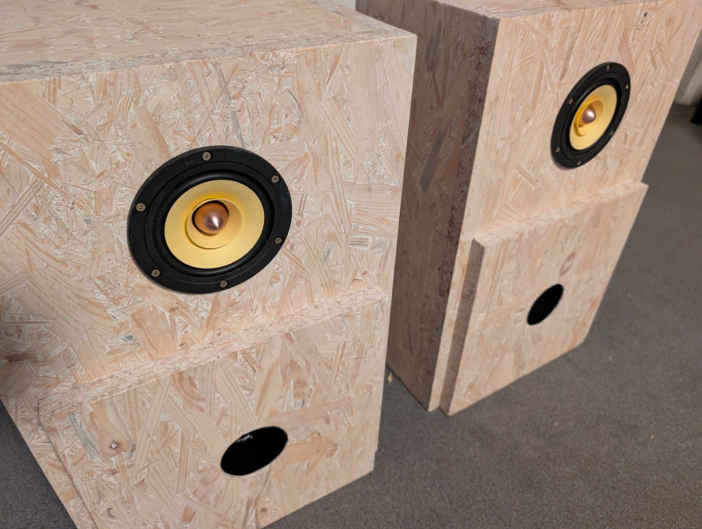

> **In short**
>
> - **One 2000 × 1000 mm board** of 22 mm OSB for the pair, a drain pipe as the port tube, one sheet
>   of sheep's wool fleece per speaker for damping.
> - **Bass flat within ±1 dB from 55 to 150 Hz, down to 47 Hz** — the box with this driver and the
>   original bare port had a +8 dB boom at 75 Hz.
> - **Box resonances −5 to −6 dB** with a damping layout that fits on the back panel.
> - Every step measured and documented, with all raw data as CSV — build it, or check it.

## Contents

[The result](#the-result) · [Build it](#build-it) · [Port tube](#port-tube) · [Damping](#damping) ·
[The driver](#the-driver-aiyima-instead-of-fostex) · [How it was measured](#how-it-was-measured) ·
[What I'd do differently](#what-id-do-differently) · [Repository map](#repository-map) ·
[Credits](#credits-and-license)

## The result

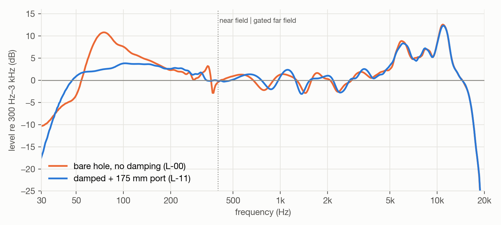

*Left speaker, 30 Hz–20 kHz, room-free. Orange: the untreated box. Blue: damped, with the 175 mm
port. Below 400 Hz the near-field driver + port sum, above it the time-gated far field.*

| | Untreated box | Damped + 175 mm port |
| --- | --- | --- |
| Port tuning Fb | 74.4 Hz | **≈ 48 Hz** |
| Bass hump at ~75 Hz | +8.1 dB | **gone** (flat ±1 dB, 55–150 Hz) |
| Bass extension (−3 dB) | 54 Hz | **47 Hz** |
| Box resonance at 350 Hz (port output) | +13 dB spike | **−6.3 dB** |
| "Honk" at ~950 Hz / ~1.5 kHz | clear peaks | **−4.7 / −6.0 dB** |
| Direct sound 300 Hz–4 kHz | ±2–3 dB | unchanged |

It doesn't sound like *more* bass — it sounds **more balanced**: the boom that read as "lots of
bass" is spread evenly down to 47 Hz. The two treble peaks at ~6 and ~10.5 kHz remain; a correction
EQ is the next step.

## Build it

| | Specification |
| --- | --- |
| **Box** | 530 × 340 × 254 mm outside, 486 × 296 × 188 mm inside = **27.0 l**, removable back |
| **Material** | one 2000 × 1000 mm board of 22 mm OSB (square edges), beech cleats, HT DN75 drain pipe |
| **Driver** | Aiyima 4" full-range, 8 Ω version (fits the Ø 94 mm cutout) |
| **Joints** | butt joints with **biscuits (size 20) and wood glue — no screws**; only the back panel is screwed, on cleats with gasket and M4 inserts |

**Both cabinets from one board:** two edge trims, five cross cuts (530 · 530 · 300 · 296 · 300),
then each piece is ripped or cut to length.

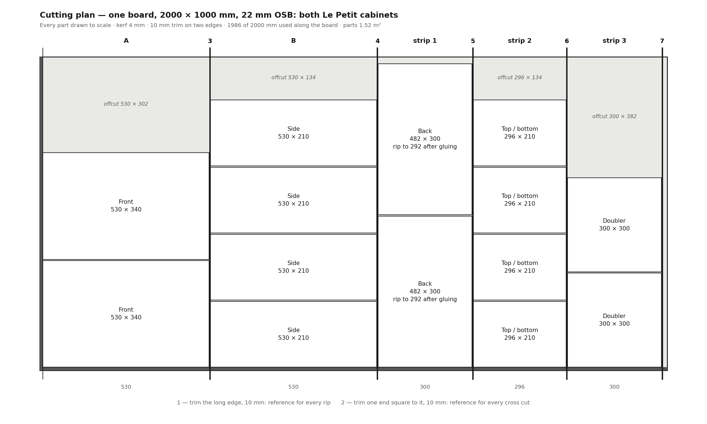

**The building plan** — three drawing sheets with every dimension, plus cut list, holes, biscuit
positions and assembly order: [docs/building-plan.md](building-plan.md).

[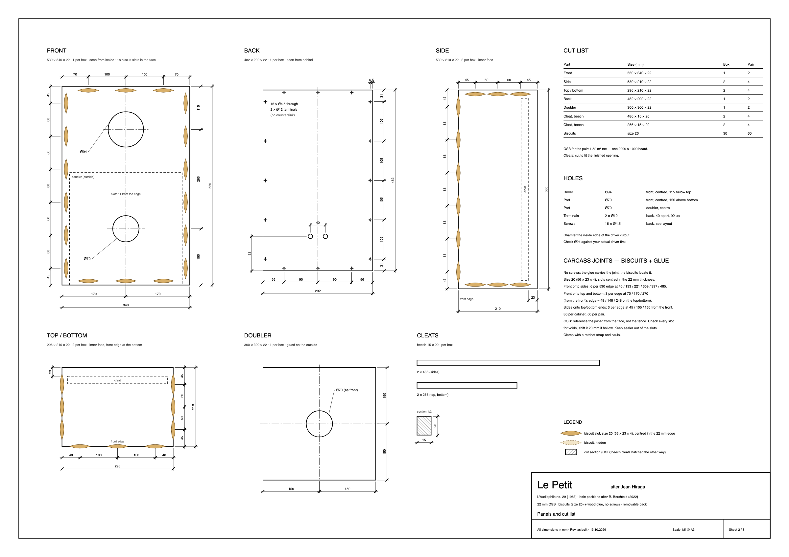](building-plan.md)

**The build guide** in 14 steps — [docs/01-build.md](01-build.md):

1. Cut the board (cutting plan above)
2. Drill the holes — Ø 94 driver, Ø 70 port in the front and the doubler, Ø 12 terminals
3. Seal the inside faces — OSB isn't airtight
4. Glue the cleats 23 mm from the rear edge
5. Biscuit slots and carcass — glued, no screws
6. Front and doubler — glued with biscuits
7. Seal the corners
8. Finish
9. Inserts and gasket
10. Fit the back panel at **292 × 482**
11. Driver and wiring
12. **Port tube, 175 mm total**
13. **Damping**
14. Close it and listen

## Port tube

An **HT DN75 drain pipe** extends the port inside the box: **175 mm total**, measured straight
through from the tube's inner end to the doubler's outer face. That tunes the box to **≈ 48 Hz**.
The original 43 Hz tuning is meant for the lean Fostex FE103NV2 next to a wall; with the Aiyima it
would droop early.

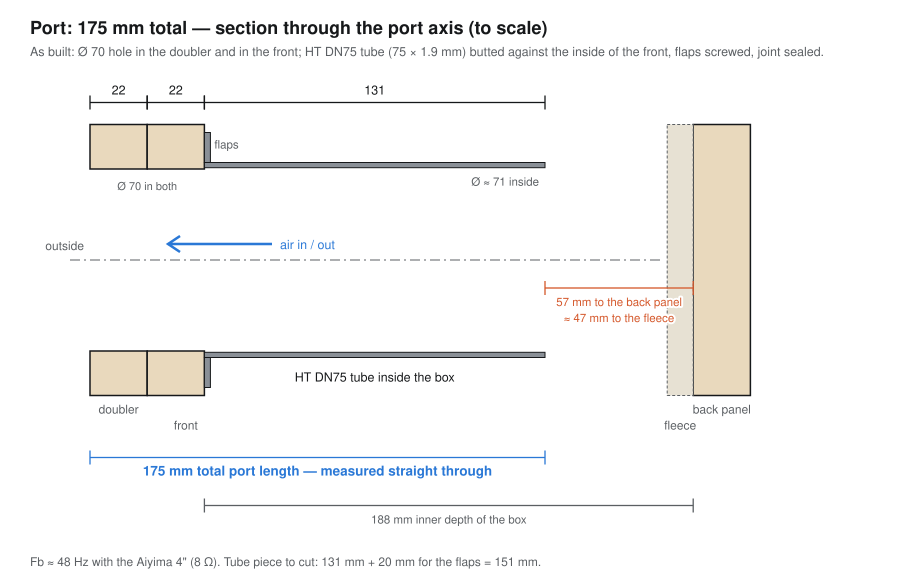

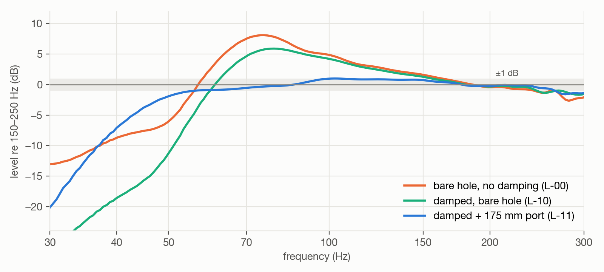

| Target Fb | Total port | |
| --- | ---: | --- |
| 55 Hz | 112 mm | fuller, less deep |
| 50 Hz | 146 mm | |
| **≈ 48 Hz** | **175 mm** | **built — flat bass** |
| 43 Hz (original) | 216 mm | doesn't fit the 188 mm box depth |

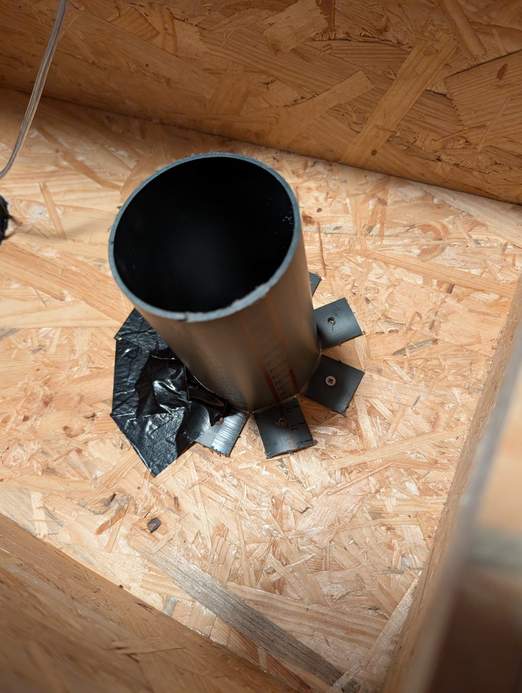

*Mounted from the inside: heat-bent flaps screwed to the front panel, joint sealed.* Details,
prediction and measurements: [docs/06-step-2-port-tube.md](06-step-2-port-tube.md).

## Damping

The box has three resonances that leak out of the port, and its dimensions predict them exactly:

| Resonance | From | Predicted | Measured |
| --- | --- | ---: | ---: |
| Height mode ("boxy") | 486 mm inner height | 353 Hz | 350–360 Hz |
| Depth mode ("honk") | 188 mm inner depth | 912 Hz | ~945 Hz |
| Port pipe resonance | 44 mm port + end corrections | ≈ 1.5 kHz | ~1.5 kHz |

Damping only works where the air moves. **The layout that came out of eight measured variants:**

- **one layer of sheep's wool fleece** (≈ 10 mm) covering the inside of the back panel (against the depth mode), and
- **a wool pocket with 50 g of loose polyester fill** across the **middle third of the height**
  (where the height mode moves the most air).

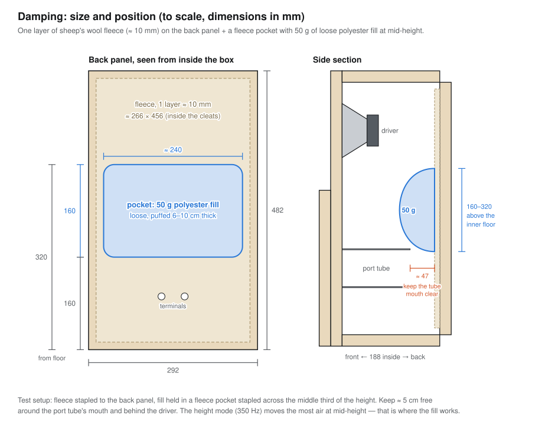

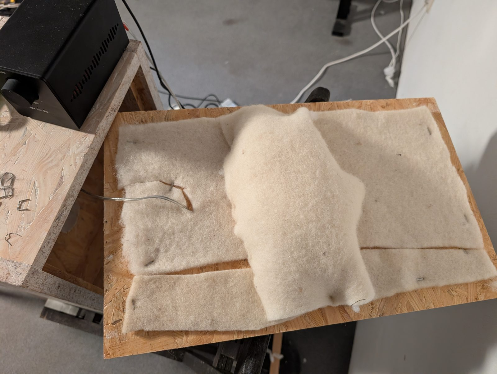

> **Test setup, not the finished state.** The damping shown here is an experimental rig, built to
> compare materials and placements: fleece cut to size and stapled in, a hand-made pocket, material
> added and taken out again between measurements. Materials: **sheep's wool garden fleece** — the
> unbleached fleece sold as a plant-protection or mulch mat, ≈ 10 mm, 350 g per 5 × 0.5 m roll
> (≈ 140 g/m²) — and **polyester fibre fill**, the synthetic stuffing found in ordinary pillows. The finished speakers
> get the same layout made neatly: fleece cut to the panel, a sewn pocket, fixed securely.

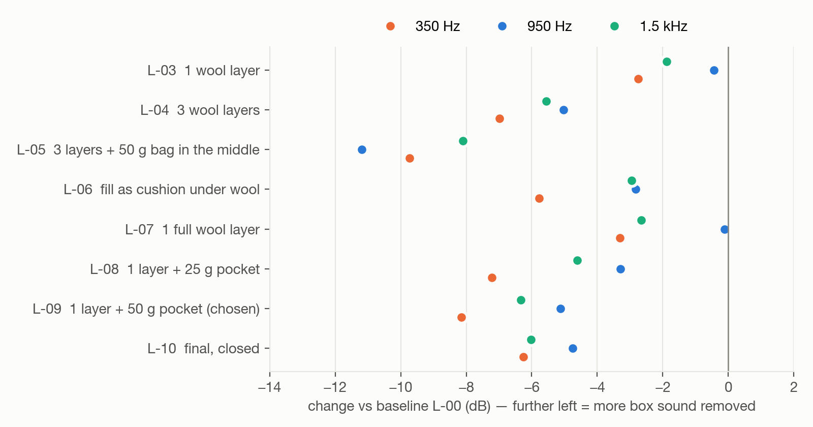

One sheet of fleece per speaker, all on the back panel, −5 to −6 dB on every resonance, direct sound
unchanged. All eight variants: [docs/05-step-1-damping.md](05-step-1-damping.md).

## The driver: Aiyima instead of Fostex

| | Original plan (FE103NV2) | This build (Aiyima 4", 8 Ω) |
| --- | --- | --- |
| Power rating | 5 W | 25 W |
| Bass | lean; needs a wall or corner | more bass of its own |
| Tuning | 43 Hz (139 mm port) | **≈ 48 Hz (175 mm port)** |
| Damping | box modes come from the box — the same for both | |

**The driver changes the port tuning, not the damping.** Note: the datasheet shipped with the
Aiyima (Re 3.4 Ω, Fs 73 Hz, Qts 0.52) is for the 4 Ω version; the impedance measurement showed the
8 Ω version. More: [docs/07-aiyima-vs-fe103.md](07-aiyima-vs-fe103.md).

## How it was measured

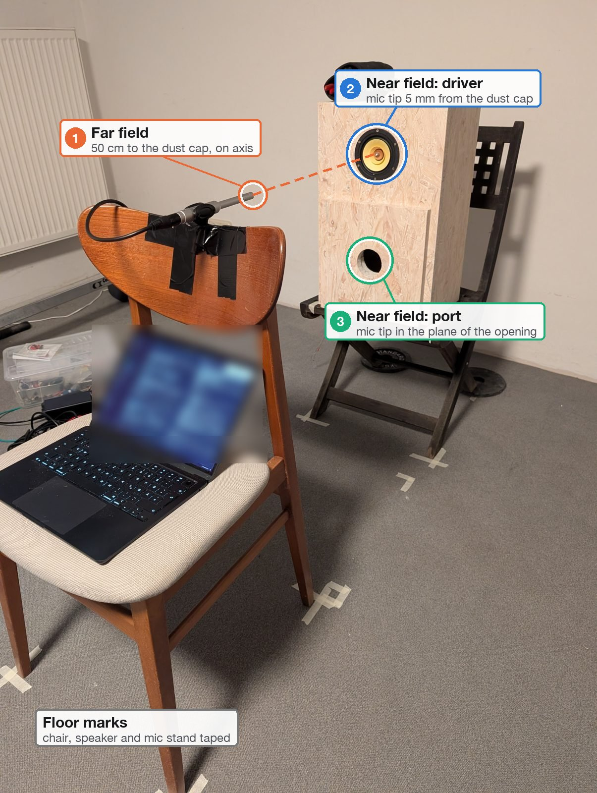

*The three microphone positions: ① far field, 50 cm on axis · ② near field, 5 mm from the dust cap · ③ near field, in the port opening.*

| Item | Role |
| --- | --- |
| Behringer UMC404 | plays the sweeps, records mic, loopback reference and the impedance jig |
| Behringer ECM8000 | measurement microphone: far field at 50 cm, near field at the cone and the port |
| Aiyima A70 | the amplifier |
| Loopback cable (OUT 2 → IN 2) | timing and level reference: cancels the interface's latency and response |
| **Impedance jig** — 2 × 100 Ω in parallel + jack leads | measures the port tuning to ±1 Hz, independent of the room |

Synchronized exponential sweeps, loopback-referenced deconvolution, a 3.4 ms gate before the floor
reflection, near-field driver + port summed with the correct phase, one change per round,
repeatability checked to 0.1–0.3 dB.

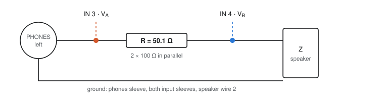

Rig: [docs/02-measurement-rig.md](02-measurement-rig.md) · Jig build guide:
[docs/03-impedance-jig.md](03-impedance-jig.md) · Method:
[docs/04-method.md](04-method.md) · Raw data: [docs/data/](data/README.md)

## What I'd do differently

> - **Measure the impedance first.** A 50 Ω resistor and two jack leads show the driver version and
>   the real port tuning in minutes.
> - **Cut the back panel 2 mm smaller than the opening** (292 × 482) and fit it with the gasket and
>   screws from the plan. A friction-fit back leaks and shifts the bass every time it's refitted.
> - **Don't trust the port calculator for a bare hole.** The box tuned to 74 Hz instead of the
>   predicted 61 Hz. Scale the tube from a measurement, cut long, trim.
> - **Put the damping by the mode, not by the panel.** One thin layer on its own did almost nothing
>   against the 950 Hz "honk"; the pocket at mid-height did.

## Repository map

```
docs/
├── 01-build.md              build guide, 14 steps, parts list, cutting plan
├── building-plan.md         the building plan: drawings, cut list, holes, joints, assembly
├── 02-measurement-rig.md    equipment, signal chain, microphone positions
├── 03-impedance-jig.md      the 50 Ω jig: parts, wiring, calibration, verification
├── 04-method.md             sweeps, windows, near-field sum, impedance estimator
├── 05-step-1-damping.md     box resonances, eight damping variants, result
├── 06-step-2-port-tube.md   port tuning from 72 to 48 Hz, result, listening test
├── 07-aiyima-vs-fe103.md    what changes with the Aiyima driver
├── 08-lessons.md            recommendations, conclusions, roadmap
├── plans/                   building-plan sheets and cutting plan (SVG) + their generator scripts
├── data/csv/                every measurement as CSV
├── data/                    raw recordings (.npz) and overview plots
└── assets/                  photos, charts, diagrams
```

| Folder | Contents |
| --- | --- |
| [docs/plans/](https://github.com/rich1704/le-petit-on-a-budget/tree/main/docs/plans/) | [sheet 1](plans/building-plan-sheet-1.svg) views and sections · [sheet 2](plans/building-plan-sheet-2.svg) panels and cut list · [sheet 3](plans/building-plan-sheet-3.svg) assembly · [cutting plan](plans/cut-layout-2000x1000.svg) · generators: [sheets](plans/make_building_plan.py), [cutting plan](plans/make_cut_layout.py) |
| [docs/data/csv/](https://github.com/rich1704/le-petit-on-a-budget/tree/main/docs/data/csv/) | frequency responses, impedance and bass sums of every session |
| [docs/data/](data/README.md) | raw impulse responses and impedance (.npz), format description |
| [docs/assets/](https://github.com/rich1704/le-petit-on-a-budget/tree/main/docs/assets/) | [photos](https://github.com/rich1704/le-petit-on-a-budget/tree/main/docs/assets/photos/), [charts](https://github.com/rich1704/le-petit-on-a-budget/tree/main/docs/assets/charts/), [diagrams](https://github.com/rich1704/le-petit-on-a-budget/tree/main/docs/assets/diagrams/) |

## Roadmap

Step 1 (damping) and Step 2 (port tube) are done for the left speaker. Next: the right speaker with
the same recipe and one check measurement, finishing (tube glued, back with gasket and screws, neat
damping), then a correction EQ for the treble peaks and room correction at the listening seat.

## Credits and license

Le Petit is **Jean Hiraga's** design (*L'Audiophile* no. 29, 1983); hole positions after
**R. Berchtold** (2022). This project stands on the plans and write-ups of everyone who has built it
before — this is my way of giving something back. Documentation, drawings, photos and data:
**CC BY-SA 4.0**; the cutting-plan script: MIT. Details: [docs/CREDITS.md](CREDITS.md).
